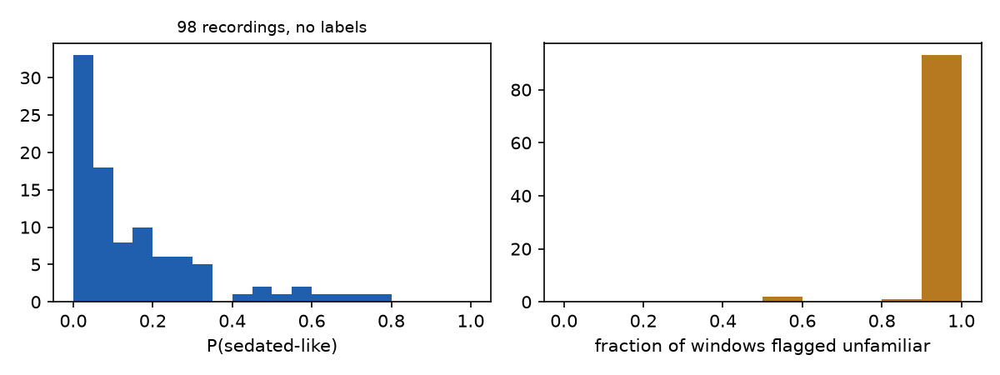

# Figshare resting-EEG set (patients with prolonged disorders of consciousness + healthy people): what the frozen sedation model does on it

Source: DOI 10.6084/m9.figshare.23552964, CC BY 4.0 (downloaded from the author's repository; 98 recordings listed, files verified by MD5). The description says 59 patients and 32 healthy people,
62 channels, 250 Hz, 60 epochs of 2 s per recording. **There is no label file** (no patient/healthy flag, no CRS-R, no diagnosis), and file names are initials only.
**Nothing below is an accuracy.** It shows that the pipeline runs on real patient-type EEG from another site, and how the model and the unfamiliar-EEG detector behave there.

| | |
|---|---|
| Recordings with data | 96 of 98 (2 have a header but no data file in the source: cp, ssy) |
| Model output | awake-like 75 · sedated-like 2 · uncertain 19 |
| P(sedated-like) quantiles (5/25/50/75/95 %) | 0.01 / 0.03 / 0.08 / 0.22 / 0.56 |
| Flagged "unfamiliar EEG" | 100 % of recordings (98 % of windows) |
| Median signal SD | 8.8 µV (the files are already cleaned and average-referenced) |

## How to read this
- The detector flagged essentially everything, as it did for EEGMMIDB: the model has only seen the Cambridge set-up, so every other system looks unfamiliar. Its thresholds have to be recalibrated on target recordings before it can act as a gate.
- Most recordings were called awake-like and only 2 sedated-like. That is **not** evidence about this dataset's patients: the model was trained to recognise propofol sedation in healthy volunteers, and disorders of consciousness are a different physiology. A model that calls patient recordings "awake-like" is unsurprising and does not mean they are awake.
- Technical caveat: each recording is 60 separate 2 s epochs joined end to end, so every 10 s window used by the model contains four joins (small discontinuities), and filtering and re-referencing were done by the authors in an unknown way.
- To use this dataset for accuracy, the author's label list is needed (ask via the Figshare record). With it, the right experiment is a model trained on patients vs healthy people with leave-one-person-out validation, not an application of the sedation model.
