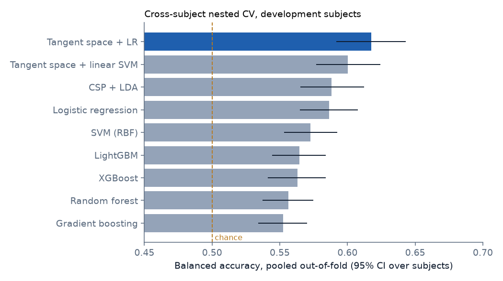
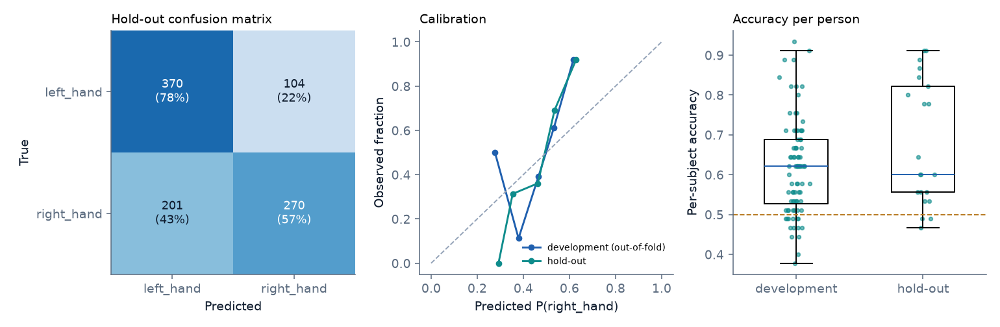
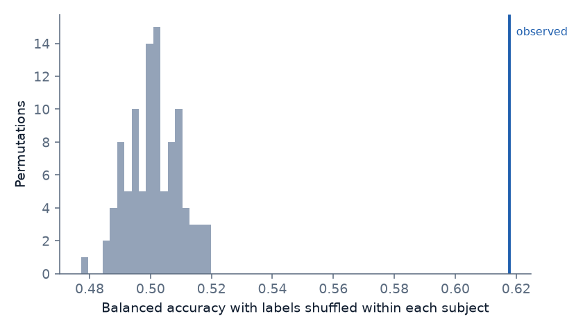

# Experiment report — left vs right (PhysioNet EEGMMIDB 1.0.0)

*Generated by `python -m nbml.report` from saved results; nothing here was typed by hand.*

> **What this is — and is not.** A benchmark of **motor-imagery decoding in healthy volunteers**
> (left hand vs right hand imagery). It is **not** a test of consciousness,
> cognitive motor dissociation (CMD) or any clinical state, and its models must not be used for diagnosis or prognosis.

## 1. Data and protocol
- Dataset: PhysioNet EEGMMIDB v1.0.0, 64 channels, 160 Hz, runs (4, 8, 12) (one cue per trial; T1 = left hand, T2 = right hand).
- **Subjects kept: 105 of 109; epochs: 4725** (class counts {'0': 2384, '1': 2341}).
- Integrity rule (fixed before any model was run; it uses file properties only, never labels or performance) excluded:
  S088 (run 4: sfreq 128.0 != 160.0); S092 (run 4: sfreq 128.0 != 160.0); S100 (run 4: sfreq 128.0 != 160.0); S104 (run 8: 13 cues != 15).
- Preprocessing (identical for everyone): common-average reference, zero-phase FIR band-pass 8–30 Hz on the continuous run, epoch 0.5–4 s after the cue.
- **Subject-independent validation.** 21 subjects were locked away as a hold-out (never used for training, tuning or model choice).
  The remaining 84 development subjects were split into 5 outer folds by subject; hyper-parameters were tuned only inside the training subjects of each fold
  (3-fold inner CV, small fixed grids). Scalers, CSP filters and the Riemannian reference mean are fitted inside each training fold.
  Leakage guards are unit-tested (`ml/tests`).
- Chance level: with 945 hold-out epochs a no-skill classifier exceeds **0.527** accuracy only 5 % of the time (binomial bound).

## 2. Model comparison (development subjects, pooled out-of-fold predictions)
| Model | Balanced accuracy [95% CI over subjects] | ROC-AUC | F1 (macro) | Precision / recall (macro) | Brier | ECE | Difference vs best [95% CI] | Fit time (min, summed) |
|---|---|---|---|---|---|---|---|---|
| Tangent space + LR | **0.618** [0.592, 0.643] | 0.661 | 0.618 | 0.618 / 0.618 | 0.239 | 0.085 | — | 17.0 |
| Tangent space + linear SVM | **0.600** [0.577, 0.624] | 0.626 | 0.600 | 0.600 / 0.600 | 0.241 | 0.042 | +0.017 [+0.006, +0.029] | 77.2 |
| CSP + LDA | **0.588** [0.565, 0.612] | 0.613 | 0.588 | 0.589 / 0.588 | 0.245 | 0.039 | +0.029 [+0.010, +0.049] | 33.1 |
| Logistic regression | **0.586** [0.565, 0.608] | 0.628 | 0.586 | 0.586 / 0.586 | 0.238 | 0.034 | +0.031 [+0.008, +0.055] | 0.1 |
| SVM (RBF) | **0.573** [0.553, 0.592] | 0.588 | 0.572 | 0.573 / 0.573 | 0.252 | 0.063 | +0.045 [+0.022, +0.069] | 2.2 |
| LightGBM | **0.564** [0.544, 0.584] | 0.586 | 0.564 | 0.565 / 0.564 | 0.262 | 0.101 | +0.053 [+0.031, +0.075] | 2.1 |
| XGBoost | **0.563** [0.541, 0.584] | 0.587 | 0.562 | 0.563 / 0.563 | 0.255 | 0.079 | +0.055 [+0.031, +0.078] | 3.3 |
| Random forest | **0.556** [0.537, 0.575] | 0.580 | 0.555 | 0.557 / 0.556 | 0.245 | 0.012 | +0.061 [+0.037, +0.086] | 5.4 |
| Gradient boosting | **0.552** [0.534, 0.570] | 0.584 | 0.552 | 0.553 / 0.552 | 0.245 | 0.032 | +0.065 [+0.042, +0.089] | 14.0 |

**Selection rule (fixed in advance):** best balanced accuracy; a model is "tied" if the paired subject-bootstrap interval of its
difference from the best includes 0; ties are broken by calibration (Brier), then interpretability, then CPU cost.
Result: best = **Tangent space + LR**; models tied with it: Tangent space + LR;
**chosen: Tangent space + LR**.

## 3. Chosen model on the locked hold-out (evaluated once)
| Metric | Value |
|---|---|
| Balanced accuracy | **0.677** (95 % CI over 21 subjects: 0.614–0.745) |
| ROC-AUC | 0.731 |
| F1 / precision / recall (macro) | 0.674 / 0.685 / 0.677 |
| Brier / ECE | 0.230 / 0.126 |
| Confusion matrix (rows = true left_hand, right_hand) | [[370, 104], [201, 270]] |
| Subjects with accuracy ≥ 70 % | 9 of 21 (median 0.60, range 0.47–0.91) |

Development CV for the same model: balanced accuracy 0.618, mean per-subject accuracy 0.618 (95 % CI 0.593–0.644).
**With only 21 hold-out subjects the hold-out number is noisy; the development estimate (based on 84 subjects) is the more reliable one.**

## 4. Label-permutation test (leakage / chance check)
Labels were shuffled within each subject 100 times and the whole outer CV repeated with the tuned hyper-parameters fixed.
Observed balanced accuracy 0.618 vs shuffled mean 0.501 (SD 0.009, max 0.520); **p = 0.0099**.
A leak-free pipeline scores ≈ 0.5 on shuffled labels; this one does.

## 5. Interpretation and limits
- Cross-subject left-vs-right imagery is genuinely hard: a sizeable share of healthy people produce little discriminable sensorimotor activity.
  Accuracy per person varies widely (figure above), so a single average hides large individual differences.
- Tree ensembles (random forest, gradient boosting, XGBoost, LightGBM) were the weakest here: with ~3780 epochs and 192 noisy band-power features they have little to exploit,
  while methods that model the spatial covariance structure (tangent space, CSP) did better — consistent with the motor-imagery literature, but this is the measured result on this dataset only.
- The chosen model is poorly calibrated (hold-out ECE 0.126); it is **under-confident** (predicted probabilities span 0.35–0.63 while observed frequencies span 0.31–0.92; strong regularisation squeezes the outputs toward 0.5). Probabilities must be recalibrated before anyone relies on them.
- On the hold-out subjects recall was 78% for left hand but 57% for right hand: the 0.5 decision threshold favours one class for new people (a subject-level shift the model does not correct).
- Healthy volunteers, one session each, 64-channel research cap: **no evidence yet** about transfer to patients, bedside montages or repeated sessions.
- Hyper-parameter grids were small and fixed; deep models (EEGNet) were **not** run in this experiment.

## 6. Exploratory follow-up: per-subject recentring (NOT part of the pre-specified comparison)
Idea: whiten each person's covariance matrices by that person's own mean covariance before the tangent-space step
(label-free; it needs only the new person's own unlabelled epochs).
- Development CV, same subjects and folds: **0.676** vs 0.618 for the pre-specified winner
  (difference **+0.058**, 95 % paired-bootstrap CI +0.039 to +0.079;
  better for 58 of 84 subjects, worse for 17). Brier 0.224 vs 0.239.
- **Status: exploratory.** It was judged on development subjects only because the locked hold-out was already used once.
  It must be confirmed on a **new** dataset (e.g. Lee 2019 / Cho 2017 through MOABB) before it is trusted.
- **Caveats:** (1) it is transductive: it needs some unlabelled data from the person being decoded; (2) it deliberately removes
  person- and session-level offsets, which helps decoding but is the *opposite* of what longitudinal tracking needs, so it must
  never be applied to the features used for session-to-session comparison.
