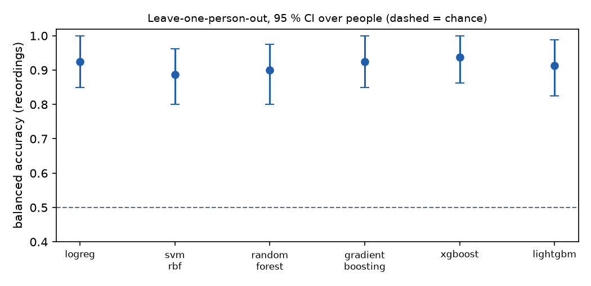
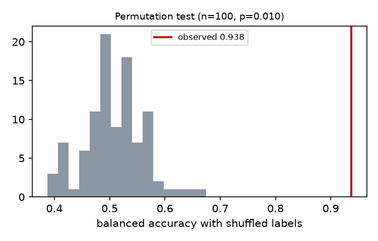
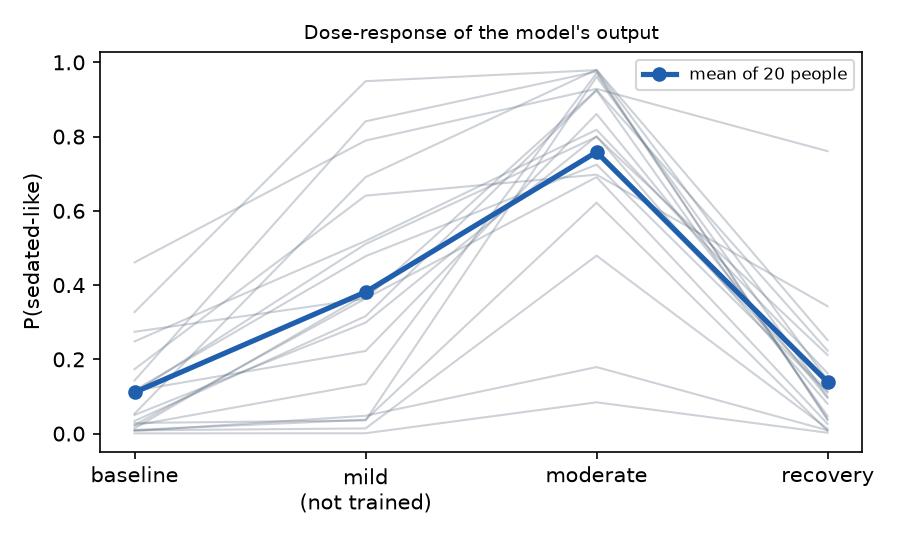
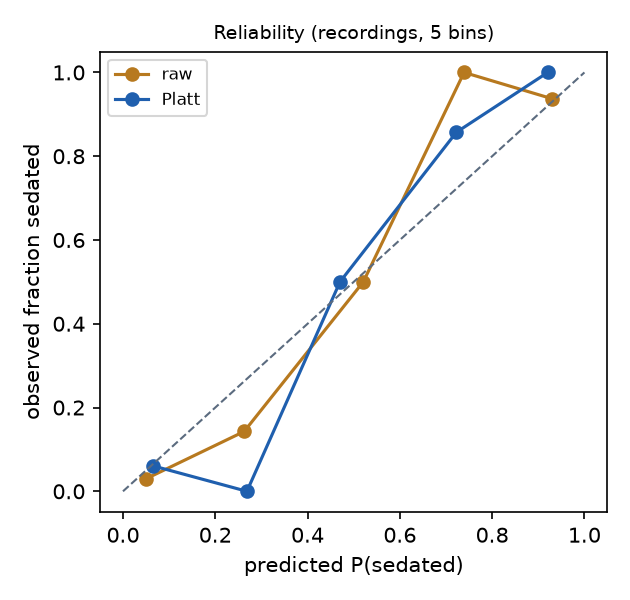
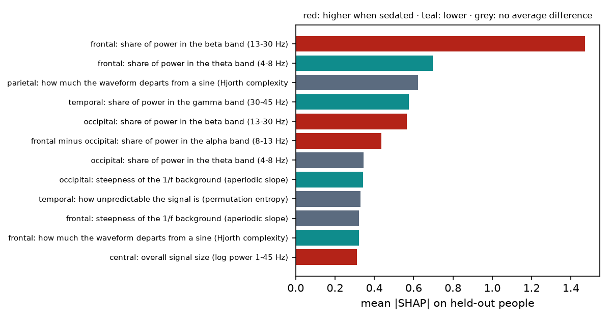

# Sedation-level model — results

**What this is:** a model trained on healthy volunteers under propofol (Chennu et al. 2016, Cambridge, CC BY 2.0 UK, DOI 10.17863/CAM.68959) that estimates how much a resting EEG *resembles* awake or moderately sedated EEG, with uncertainty and an explanation. **What it is not:** a diagnosis, a consciousness or covert-awareness detector for patients, or a measure of recovery. It has never seen a patient.

Protocol, fixed before any model was trained: [PRESPEC.md](PRESPEC.md). Code: `nbml/sed_*.py`.

## 1. Can it tell awake from moderately sedated in a new person?

Leave-one-person-out (20 folds, no person in both training and test; tuning inside the training people only). 60 recordings (20 people × baseline / moderate / recovery). Unit of analysis: the recording (mean of its epoch probabilities).

| Model | Balanced accuracy (recordings) | 95 % CI (over people) | AUC | Brier | ECE | Balanced accuracy (epochs) |
|---|---|---|---|---|---|---|
| logreg | 0.925 | 0.85–1.00 | 0.935 | 0.080 | 0.117 | 0.875 |
| svm_rbf | 0.887 | 0.80–0.96 | 0.943 | 0.094 | 0.106 | 0.834 |
| random_forest | 0.900 | 0.80–0.97 | 0.943 | 0.089 | 0.134 | 0.863 |
| gradient_boosting | 0.925 | 0.85–1.00 | 0.958 | 0.063 | 0.068 | 0.884 |
| xgboost | 0.938 | 0.86–1.00 | 0.970 | 0.056 | 0.062 | 0.888 |
| lightgbm | 0.912 | 0.82–0.99 | 0.966 | 0.061 | 0.057 | 0.872 |

**No model is statistically better than another** (every pairwise 95 % interval of the difference includes 0). The pre-specified rule therefore picks the best-calibrated model: **xgboost** (lowest Brier score). Treat the ranking as noise; with 20 people the six models are interchangeable here.

Chosen model (xgboost): balanced accuracy **0.938** (95 % CI 0.86–1.00), AUC 0.970.

**Permutation test:** with labels shuffled among each person's own recordings the same pipeline reaches 0.509 on average (95th percentile 0.587); observed 0.938, p = 0.010 (with 100 permutations the smallest possible p is 0.010).

**Caveats.** Selection among six models used the same cross-validation as the estimate (grids are tiny and fixed, so the optimism is small but not zero). 20 healthy people is a small sample, and propofol sedation in healthy adults is a much easier and cleaner problem than brain injury.

## 2. Does the output behave like a dose-response? (mild sedation was never used in training)

| Level | n | mean P(sedated-like) | SD |
|---|---|---|---|
| baseline | 20 | 0.11 | 0.13 |
| mild sedation | 20 | 0.38 | 0.29 |
| moderate sedation | 20 | 0.76 | 0.25 |
| recovery | 20 | 0.14 | 0.17 |

Mild sedation sat between baseline and moderate for the group, and was higher than the same person's baseline in 100 % of people (mean +0.27). Across all 80 recordings the output correlates with measured plasma propofol (Spearman ρ = 0.72) and negatively with correct responses in the behavioural task (ρ = -0.45). Recovery returned to near baseline. This is the most convincing single result: the model was not trained on this level.

## 3. Can its probabilities be trusted?

Calibration (recording level, leave-one-person-out): raw ECE 0.062, Brier 0.056; after Platt scaling ECE 0.074, Brier 0.065. Platt scaling slightly worsened the already reasonable xgboost probabilities; the difference is inside what 60 recordings can resolve. Platt scaling was pre-specified, so it is kept, but this is an open decision.

**Uncertainty (split-conformal sets, target 80 % coverage, checked on each held-out person):** coverage 83 %; a single class was returned for 88 % of recordings and was right 94 % of the time; 12 % of recordings were answered "uncertain" (neither or both classes fit).

## 4. What does it look at? (SHAP on held-out people)

| # | Feature (plain language) | mean abs SHAP | Higher when sedated? | Sign consistent across people |
|---|---|---|---|---|
| 1 | frontal: share of power in the beta band (13-30 Hz) | 1.47 | yes (+1.19 SD) | 70 % |
| 2 | frontal: share of power in the theta band (4-8 Hz) | 0.70 | no, lower (-0.72 SD) | 50 % |
| 3 | parietal: how much the waveform departs from a sine (Hjorth complexity) | 0.62 | about the same (+0.03 SD) | 45 % |
| 4 | temporal: share of power in the gamma band (30-45 Hz) | 0.57 | no, lower (-0.69 SD) | 35 % |
| 5 | occipital: share of power in the beta band (13-30 Hz) | 0.57 | yes (+0.71 SD) | 60 % |
| 6 | frontal minus occipital: share of power in the alpha band (8-13 Hz) | 0.44 | yes (+1.01 SD) | 65 % |
| 7 | occipital: share of power in the theta band (4-8 Hz) | 0.34 | about the same (+0.10 SD) | 50 % |
| 8 | occipital: steepness of the 1/f background (aperiodic slope) | 0.34 | no, lower (-0.39 SD) | 55 % |
| 9 | temporal: how unpredictable the signal is (permutation entropy) | 0.33 | about the same (-0.18 SD) | 45 % |
| 10 | frontal: steepness of the 1/f background (aperiodic slope) | 0.32 | about the same (-0.14 SD) | 70 % |

Amplitude-only features among the top five: **no** (pre-specified warning sign). Two of the leading effects point the way the propofol literature describes (frontal beta share up; frontal-minus-occipital alpha difference up, i.e. alpha moves forward), but others (parietal Hjorth complexity, temporal gamma) have no simple interpretation I can vouch for. A feature can matter without differing in its average (SHAP also captures interactions), and the sign of its contribution was not consistent in every person (last column): treat explanations as hints, not proof.

## 5. Does it know when it is out of its depth?

Unfamiliar-EEG detector (PCA: Hotelling T² and residual SPE, 99th-percentile thresholds): on held-out people from the same dataset it flagged 8.2 % of epochs (the percentile alone predicts about 2 %: new people differ systematically); 6.7 % of recordings (4 of 60) had more than 25 % of epochs flagged.

**External sanity check on a different dataset** (EEGMMIDB, 109 awake healthy people, another device and site, filtered here with the same Butterworth band-pass; 218 eyes-open / eyes-closed recordings, all truly awake):

- called sedated: 4.1 % (so 95.9 % correctly not sedated; this tests specificity only — it says nothing about detecting sedation on another device);
- conformal verdict: 87 % awake-like, 0.5 % sedated-like, 13 % uncertain;
- eyes open vs closed: mean P(sedated-like) 0.17 vs 0.08 — the model leans towards "sedated" when alpha is reduced for any reason, including simply having the eyes open (the repository page does not state the eye state of the training recordings);
- **unfamiliar-EEG flag: 100 % of these recordings.** The detector therefore fired on every recording from another site. It is honest (a different device really does look different) but it cannot yet separate 'usable' from 'unusable' foreign data: its thresholds must be re-calibrated on the target clinical recordings before it can act as a gate. Until then a recording outside the Cambridge set-up should always be labelled "unfamiliar".

## 6. What this answers, and what it does not

- It supports the claim that a pipeline of standard spectral, entropy and connectivity features plus tree-based or linear models can read propofol sedation level from **new healthy people's** resting EEG, with explanations and uncertainty.
- It does **not** show that the same works for patients with disorders of consciousness, for other drugs, for brain injury, or for other EEG systems. That needs EEG from patients with labels (e.g. CRS-R category or outcome). No such open dataset was found; one open resting-EEG set of patients exists on Figshare (DOI 10.6084/m9.figshare.23552964) but it has **no label file**, so it can only be used to test the pipeline and the unfamiliar-EEG detector, not to measure accuracy.
- The dataset's EEG was already cleaned by its authors (0.5–45 Hz, ICA, epoch rejection), so it cannot test the new FastICA blink removal; that was tested separately on simulated blinks.
- "Recovering" is a statement about change over time within one patient, which this model does not provide by itself; that is the job of the longitudinal comparison (Phase 6).

## 7. Files

`ml/models/sedation_v1/model.joblib` (+ `model_card.json`, SHA-256 recorded; registered as *staging* in MongoDB `neurobridge_ml.model_registry`), `ml/reports/sedation/results.json`, `oof.npz` (all out-of-fold predictions), `cv_params.json`.
