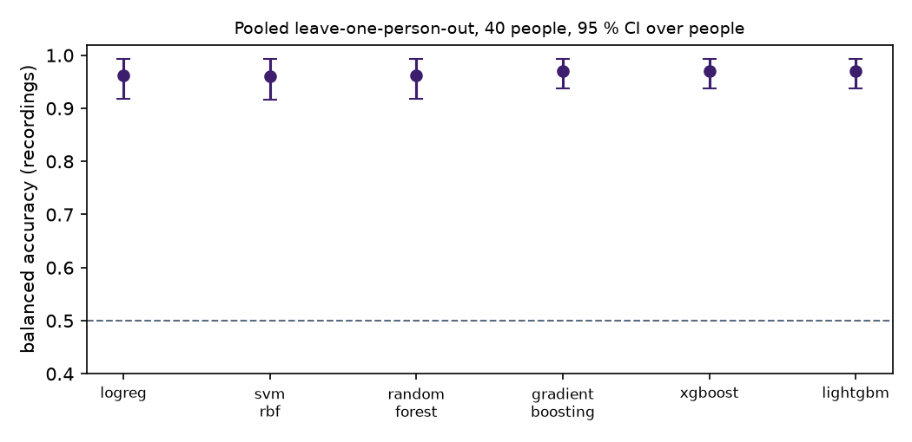
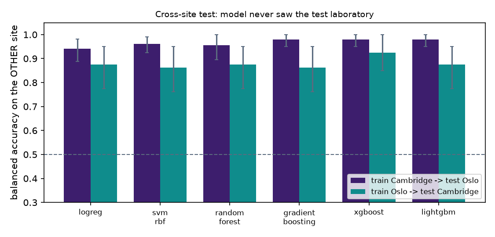
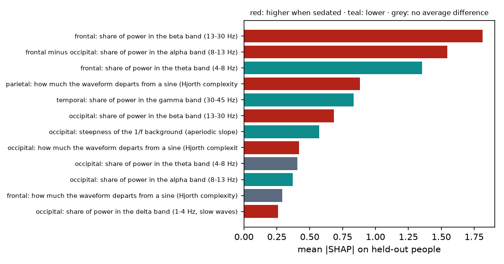
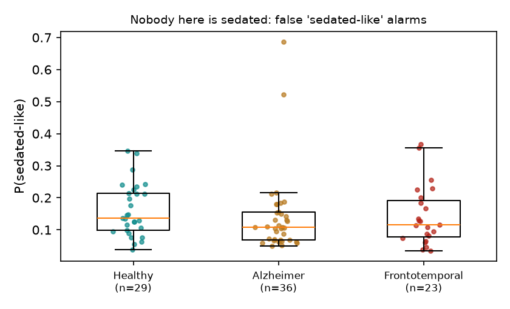

# Multi-site sedation-level model (v2) - results

Protocol fixed before training: [PRESPEC.md](PRESPEC.md). Code: `nbml/sedm_*.py`, `oslo_data.py`, `prep.py`. **Research decision support; the model has never seen a patient.**

## 1. Data

40 healthy people from two laboratories (Cambridge 20, Oslo 20), 131 recordings in the primary task, 68 features (primary set: the 74 v1 features without the six amplitude-dependent log-power features). Oslo is raw 5 kHz Brain Products EEG prepared here (notch, Butterworth 0.5-45 Hz, EOG regression, average reference, artefact rejection); Cambridge is used as in v1.

## 2. Pooled leave-one-person-out (40 folds)

| Model | Balanced accuracy | 95 % CI (people) | AUC | Brier | Cambridge BA | Oslo BA |
|---|---|---|---|---|---|---|
| logreg | 0.962 | 0.92-0.99 | 0.985 | 0.045 | 0.925 | 0.990 |
| svm_rbf | 0.961 | 0.92-0.99 | 0.986 | 0.037 | 0.913 | 1.000 |
| random_forest | 0.962 | 0.92-0.99 | 0.984 | 0.051 | 0.925 | 0.990 |
| gradient_boosting | 0.971 | 0.94-0.99 | 0.988 | 0.035 | 0.938 | 0.990 |
| xgboost | 0.971 | 0.94-0.99 | 0.990 | 0.033 | 0.938 | 0.990 |
| lightgbm | 0.971 | 0.94-0.99 | 0.992 | 0.030 | 0.938 | 0.990 |

All six models are statistically tied; the pre-specified rule chose **lightgbm** (lowest Brier score). Chosen model: balanced accuracy **0.971** (95 % CI 0.94-0.99), AUC 0.992. Permutation test (100 shuffles): null mean 0.579, p = 0.010.

## 3. Cross-site test (the generalisation result)

| Model | Train | Test | Balanced accuracy | 95 % CI | AUC | awake called sedated | sedated called sedated |
|---|---|---|---|---|---|---|---|
| logreg | Cambridge | Oslo | 0.941 | 0.89-0.98 | 0.995 | 0 % | 88 % |
| logreg | Oslo | Cambridge | 0.875 | 0.78-0.95 | 0.929 | 5 % | 80 % |
| svm_rbf | Cambridge | Oslo | 0.961 | 0.92-0.99 | 0.999 | 0 % | 92 % |
| svm_rbf | Oslo | Cambridge | 0.863 | 0.76-0.95 | 0.922 | 8 % | 80 % |
| random_forest | Cambridge | Oslo | 0.955 | 0.90-1.00 | 0.996 | 5 % | 96 % |
| random_forest | Oslo | Cambridge | 0.875 | 0.77-0.95 | 0.916 | 15 % | 90 % |
| gradient_boosting | Cambridge | Oslo | 0.980 | 0.95-1.00 | 0.993 | 0 % | 96 % |
| gradient_boosting | Oslo | Cambridge | 0.863 | 0.76-0.95 | 0.931 | 8 % | 80 % |
| xgboost | Cambridge | Oslo | 0.980 | 0.95-1.00 | 0.997 | 0 % | 96 % |
| xgboost | Oslo | Cambridge | 0.925 | 0.85-1.00 | 0.936 | 5 % | 90 % |
| lightgbm | Cambridge | Oslo | 0.980 | 0.95-1.00 | 0.997 | 0 % | 96 % |
| lightgbm | Oslo | Cambridge | 0.875 | 0.78-0.95 | 0.922 | 5 % | 80 % |

**Pre-specified criteria for the chosen model** (lightgbm):

- pooled ba gt 0.80: **met**
- cross site lower ci gt 0.5 both: **met**
- permutation p lt 0.05: **met**
- warning 'cross site ba lt 0.65': **not triggered**
- warning 'one class dominates test site': **not triggered**
- warning 'permutation p ge 0.05': **not triggered**

**Overall: all success criteria met and no warning triggered.**

Sensitivity analysis with all 74 features (including amplitude): chosen lightgbm, pooled balanced accuracy 0.956; cross-site train Cambridge: 0.971, train Oslo: 0.850.

## 4. Reliability

- Calibration (leave-one-person-out Platt): raw ECE 0.032, Brier 0.030; Platt ECE 0.071, Brier 0.039.
- Conformal sets (target 80 %): coverage 82 %; single answer for 84 % of recordings, right 97 % of those; "uncertain" 16 %.
- Cambridge dose-response (mild never trained): baseline 0.10, mild 0.38, moderate 0.76, recovery 0.15; Spearman with plasma propofol 0.73. Oslo mean output: awake 0.07, sedated 0.92.
- Unfamiliar-EEG detector: held-out people of the same pooled data flagged 5.6 % of epochs; train Cambridge flags Oslo: 37 % of epochs; train Oslo flags Cambridge: 10 % of epochs.

## 5. What the model uses (SHAP, held-out people)

| # | Feature | mean abs SHAP | Higher when sedated? |
|---|---|---|---|
| 1 | frontal: share of power in the beta band (13-30 Hz) | 1.81 | yes (+0.98 SD) |
| 2 | frontal minus occipital: share of power in the alpha band (8-13 Hz) | 1.55 | yes (+1.13 SD) |
| 3 | frontal: share of power in the theta band (4-8 Hz) | 1.35 | lower (-0.81 SD) |
| 4 | parietal: how much the waveform departs from a sine (Hjorth complexity) | 0.88 | yes (+0.48 SD) |
| 5 | temporal: share of power in the gamma band (30-45 Hz) | 0.83 | lower (-0.73 SD) |
| 6 | occipital: share of power in the beta band (13-30 Hz) | 0.68 | yes (+0.58 SD) |
| 7 | occipital: steepness of the 1/f background (aperiodic slope) | 0.57 | lower (-0.53 SD) |
| 8 | occipital: how much the waveform departs from a sine (Hjorth complexity) | 0.42 | yes (+0.69 SD) |
| 9 | occipital: share of power in the theta band (4-8 Hz) | 0.41 | about the same (-0.09 SD) |
| 10 | occipital: share of power in the alpha band (8-13 Hz) | 0.37 | lower (-1.15 SD) |

## 6. Observational check on clinical EEG (ds004504; nobody is sedated)

| Group | n | mean P(sedated-like) | called sedated | verdict awake / sedated / uncertain | unfamiliar-EEG flagged |
|---|---|---|---|---|---|
| Healthy | 29 | 0.16 | 0 % | 62 % / 0 % / 38 % | 31 % |
| Alzheimer | 36 | 0.14 | 6 % | 86 % / 0 % / 14 % | 28 % |
| Frontotemporal | 23 | 0.14 | 0 % | 74 % / 0 % / 26 % | 43 % |

Spearman correlation of P(sedated-like) with MMSE (30 = normal): 0.15 (p = 0.175). 10.7 % of 10-s epochs were rejected as artefact. Interpretation: this measures how often a model trained on sedated volunteers raises a false 'sedated-like' alarm on routine clinical EEG; EEG slowing in dementia is a known confounder, so a higher rate in patients than in healthy controls is a limit of the model, not a finding about the patients.

## 7. Comparison with v1 and decision

v1 (Cambridge only, 20 people, 74 features): balanced accuracy 0.938, never tested on another site. v2 (two sites, 40 people, 68 features): pooled 0.971; cross-site train Cambridge -> test Oslo: 0.980 (0.95-1.00), train Oslo -> test Cambridge: 0.875 (0.78-0.95). The pre-specified criteria are met, so v2 is registered as the staging model and can be selected in the app (setting `sedation_model`).

## 8. Limits

- 40 healthy volunteers in two laboratories; intervals stay wide. Oslo has ungraded, probably deeper sedation than Cambridge 'moderate'.
- Nothing here shows the model works on brain-injured patients; the clinical-EEG check above is observational.
- Oslo recordings are short (60 s asleep-like, first 120 s awake) and few per person.
- Selection among six models used the same cross-validation as the estimate (tiny fixed grids).
